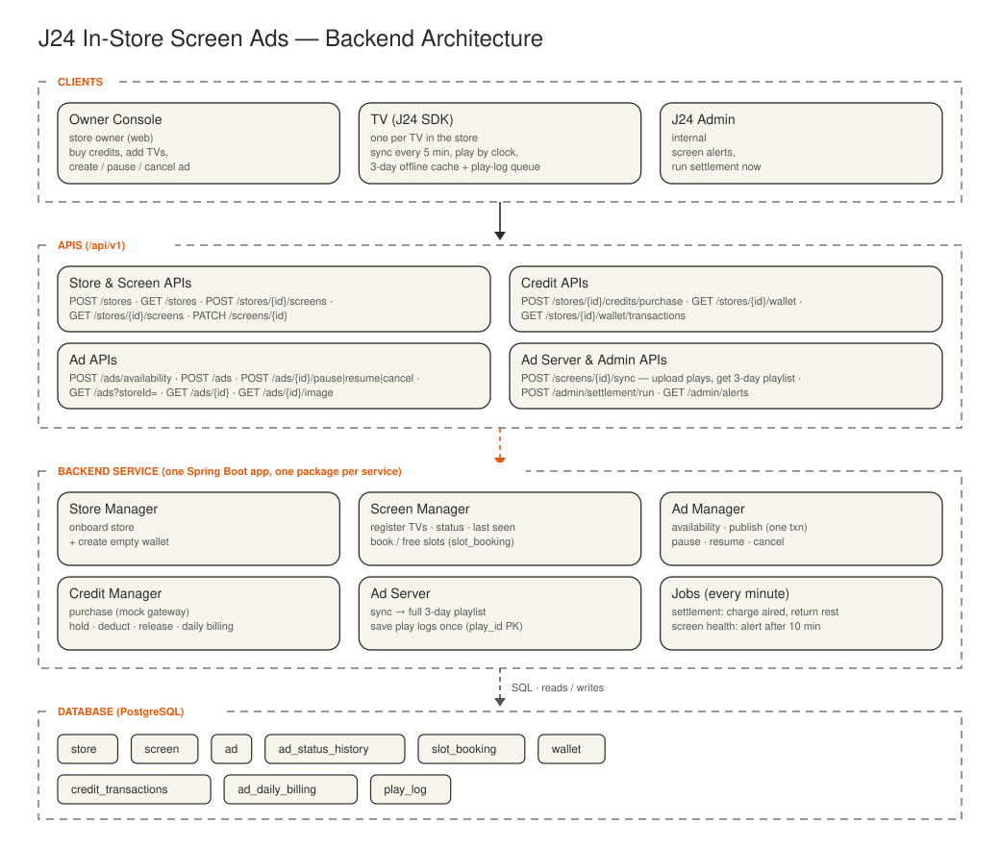
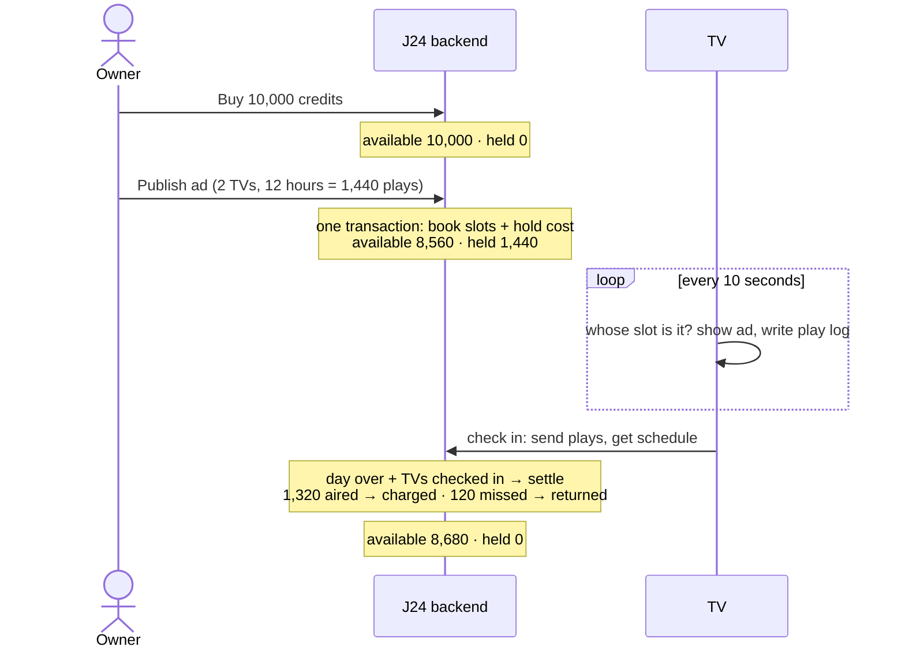

# J24 In-Store Screen Ads

- Store owners book short ads on the TVs inside their own shop.
- They pay only for the plays that actually air.
- One backend, split into a few clearly separated services, with one database.
- Each TV runs a small J24 app: it fetches its schedule, keeps playing when the internet drops, and reports back what it showed.

- [01 Architecture diagram](#01-architecture-diagram)
- [02 Database schema](#02-database-schema)
- [03 API endpoints](#03-api-endpoints)
- [04 How credits work](#04-how-credits-work)
- [05 Assumptions](#05-assumptions)

---

## 01 Architecture diagram



| Service | Owns | Does |
|---|---|---|
| Store Manager | `store` | Onboards a store and creates its empty wallet |
| Screen Manager | `screen`, `slot_booking` | Registers TVs, tracks last sync, books and frees slots |
| Ad Manager | `ad` | Availability, publish, pause, resume, cancel |
| Credit Manager | `wallet`, `credit_transactions`, `ad_daily_billing` | Buy credits, hold at publish, charge or return at settlement |
| Ad Server | `play_log` | Gives each TV its 3-day playlist, stores the plays it reports |

---

## 02 Database schema

### At a glance

- **store**: id, name, owner_name
- **screen**: id (UUID), store_id, name, placement_type (ENTRANCE / NEAR_CHECKOUT / AISLE / OTHER), status (ACTIVE / INACTIVE), last_seen_at
  - Every screen loops 6 slots of 10 seconds, so slots need no table of their own.
- **ad**: id, store_id, name, headline, image (bytes), start_time, end_time, status (ACTIVE / PAUSED / CANCELLED), price_per_play, total_cost
- **slot_booking**: id, ad_id, screen_id, slot_index, start_time, end_time, active
  - One row per slot an ad books; one screen can hold several slots of the same ad.
- **wallet**: store_id PK, available, held (neither can go below zero)
  - Like the balance in a bank app: one row per store, updated in place.
  - available = credits free to spend; held = credits reserved for booked ads.
  - This row is locked during publish so two ads can't spend the same credits.
- **credit_transactions** (only added, never edited): id, store_id, type (PURCHASE / HOLD / DEDUCT / RELEASE), amount (always positive), ad_id (which ad caused it; empty for PURCHASE)
  - Like a bank statement: one row per change.
  - Shows how the balance got there, e.g. PURCHASE 10,000 → HOLD 1,440 → DEDUCT 1,320 → RELEASE 120.
  - Written together with the wallet, so the wallet can always be rebuilt from this history.
- **ad_daily_billing** (one row per ad per day): id, ad_id, date, booked_plays, held, status (HELD / SETTLED), deducted, released
  - booked_plays = minutes of the ad's range on that day × number of slots booked.
- **play_log**: play_id (UUID made on the TV) PK, screen_id, ad_id, slot_index, played_at

### Tables in detail

- All sample rows belong to **one ad on two TVs of Kirana store 1**, so the same ids appear across tables.
- The ad runs 1 Nov 2026, 09:00–21:00: 720 plays per TV, 1,440 in total, at 1 credit per play.

### 1. store

- One row per shop that uses J24.

| Column | Type | Notes |
|---|---|---|
| id | UUID PK | Made by the server |
| owner_name | TEXT NOT NULL | Who runs the shop |
| name | TEXT NOT NULL | Shop name shown in the console |

Sample row
```json
{
  "id": "store_kirana_1",
  "owner_name": "Ramesh Sharma",
  "name": "Kirana store 1"
}
```

### 2. screen

- One row per TV.
- Each TV loops 6 slots of 10 seconds, so a slot is just a number 0–5 (no slots table).

| Column | Type | Notes |
|---|---|---|
| id | UUID PK | Made by the server, so many stores can onboard at once with no clashes |
| store_id | UUID NOT NULL FK | The store the TV is in |
| name | TEXT NOT NULL | e.g. "Entrance TV" |
| placement_type | TEXT NOT NULL | ENTRANCE / NEAR_CHECKOUT / AISLE / OTHER |
| status | TEXT NOT NULL | ACTIVE / INACTIVE. Inactive TVs can't be booked and show house content |
| last_seen_at | TIMESTAMPTZ | Last sync. More than 10 minutes old → screen-health alert |

Sample rows
```json
[
  {
    "id": "screen_entrance",
    "store_id": "store_kirana_1",
    "name": "Entrance TV",
    "placement_type": "ENTRANCE",
    "status": "ACTIVE",
    "last_seen_at": "2026-11-01T21:03:00+05:30"
  },
  {
    "id": "screen_checkout",
    "store_id": "store_kirana_1",
    "name": "Checkout TV",
    "placement_type": "NEAR_CHECKOUT",
    "status": "ACTIVE",
    "last_seen_at": "2026-11-01T21:04:00+05:30"
  }
]
```

### 3. ad

- What the owner wants to show, for how long, and what it costs.
- The image is stored in the row.

| Column | Type | Notes |
|---|---|---|
| id | UUID PK | Made by the server |
| store_id | UUID NOT NULL FK | Owner's store |
| name | TEXT NOT NULL | Internal name |
| headline | TEXT NOT NULL | Text shown over the image |
| image | BYTEA | The picture; TVs download it once and cache it |
| start_time / end_time | TIMESTAMPTZ NOT NULL | One continuous range; `end_time > start_time` |
| status | TEXT NOT NULL | ACTIVE / PAUSED / CANCELLED. "ENDED" isn't stored: it's an ACTIVE or PAUSED ad past its end_time |
| price_per_play | BIGINT NOT NULL | 1 credit |
| total_cost | BIGINT NOT NULL | Plays per slot × slots booked × price; held at publish |

Sample row
```json
{
  "id": "ad_diwali_sale",
  "store_id": "store_kirana_1",
  "name": "Diwali sale",
  "headline": "Flat 20% off on sweets",
  "start_time": "2026-11-01T09:00:00+05:30",
  "end_time": "2026-11-01T21:00:00+05:30",
  "status": "ACTIVE",
  "price_per_play": 1,
  "total_cost": 1440
}
```

### 4. slot_booking

- One ad on one slot of one TV for a time range.
- Owned by Screen Manager, because slots belong to a screen.

| Column | Type | Notes |
|---|---|---|
| ad_id | UUID NOT NULL FK | The ad that booked it |
| screen_id | UUID NOT NULL FK | The TV |
| slot_index | INT NOT NULL | 0–5 |
| start_time / end_time | TIMESTAMPTZ NOT NULL | Copied from the ad |
| active | BOOLEAN NOT NULL DEFAULT TRUE | Set to false on cancel, which frees the slot. Pause keeps it true |

- A slot is free when no active booking on the same TV and slot overlaps the new time range.

Sample rows
```json
[
  { "ad_id": "ad_diwali_sale", "screen_id": "screen_entrance", "slot_index": 2,
    "start_time": "2026-11-01T09:00:00+05:30", "end_time": "2026-11-01T21:00:00+05:30", "active": true },
  { "ad_id": "ad_diwali_sale", "screen_id": "screen_checkout", "slot_index": 0,
    "start_time": "2026-11-01T09:00:00+05:30", "end_time": "2026-11-01T21:00:00+05:30", "active": true }
]
```

### 5. wallet

- The store's current balance, one row per store.
- Locked while an ad is published, so two ads can't spend the same credits.

| Column | Type | Notes |
|---|---|---|
| store_id | UUID PK FK | One wallet per store |
| available | BIGINT NOT NULL, ≥ 0 | Free to spend; can never go negative |
| held | BIGINT NOT NULL, ≥ 0 | Reserved for booked ads not yet settled |

Sample row (after the day is settled)
```json
{ "store_id": "store_kirana_1", "available": 8680, "held": 0 }
```

### 6. credit_transactions

- The statement: every credit movement, never edited.
- Always written together with the wallet change.

| Column | Type | Notes |
|---|---|---|
| store_id | UUID NOT NULL FK | Whose credits |
| type | TEXT NOT NULL | PURCHASE (bought) / HOLD (reserved at publish) / DEDUCT (charged for plays) / RELEASE (returned) |
| amount | BIGINT NOT NULL, > 0 | Always positive; the type says the direction |
| ad_id | UUID FK | The ad behind the movement; null for PURCHASE |

Sample rows
```json
[
  { "store_id": "store_kirana_1", "type": "PURCHASE", "amount": 10000, "ad_id": null },
  { "store_id": "store_kirana_1", "type": "HOLD",     "amount": 1440,  "ad_id": "ad_diwali_sale" },
  { "store_id": "store_kirana_1", "type": "DEDUCT",   "amount": 1320,  "ad_id": "ad_diwali_sale" },
  { "store_id": "store_kirana_1", "type": "RELEASE",  "amount": 120,   "ad_id": "ad_diwali_sale" }
]
```

### 7. ad_daily_billing

- One row per ad per day: how much was held for that day and how it was settled.

| Column | Type | Notes |
|---|---|---|
| ad_id | UUID NOT NULL FK | The ad |
| date | DATE NOT NULL | The day |
| booked_plays | INT NOT NULL | Plays booked that day across all its TVs |
| held | BIGINT NOT NULL | Credits held for that day |
| status | TEXT NOT NULL | HELD / SETTLED |
| deducted | BIGINT NOT NULL DEFAULT 0 | Charged: plays that aired while ACTIVE, capped per booked slot |
| released | BIGINT NOT NULL DEFAULT 0 | Returned: held − deducted |

- A day settles once it is over and every TV of the ad has checked in since, or after 72 hours.

Sample row (the checkout TV was off for 2 hours, so 120 plays didn't air)
```json
{
  "ad_id": "ad_diwali_sale",
  "date": "2026-11-01",
  "booked_plays": 1440,
  "held": 1440,
  "status": "SETTLED",
  "deducted": 1320,
  "released": 120
}
```

### 8. play_log

- One row per play a TV reports.
- The TV makes `play_id`, so sending the same plays twice counts them once.

| Column | Type | Notes |
|---|---|---|
| play_id | UUID PK | Made on the TV |
| screen_id | UUID NOT NULL FK | Which TV played it |
| ad_id | UUID NOT NULL FK | Which ad |
| slot_index | INT NOT NULL | Which slot |
| played_at | TIMESTAMPTZ NOT NULL | When it was shown |

Sample row
```json
{
  "play_id": "play_9c41",
  "screen_id": "screen_entrance",
  "ad_id": "ad_diwali_sale",
  "slot_index": 2,
  "played_at": "2026-11-01T09:00:20+05:30"
}
```

---

## 03 API endpoints

### Store and screens

- **Onboard a store** · `POST /stores`
  - Creates the store and its empty wallet.
- **List stores** · `GET /stores`
- **Add a TV** · `POST /stores/{storeId}/screens`
  - The server gives the TV its id.
- **List TVs** · `GET /stores/{storeId}/screens`
  - Shows each TV and whether it checked in during the last 10 minutes.
- **Turn a TV on or off for ads** · `PATCH /screens/{screenId}`

### Credits

- **Buy credits** · `POST /stores/{storeId}/credits/purchase`
  - Payment is mocked and always succeeds; credits are added to the balance.
- **See balance** · `GET /stores/{storeId}/wallet`
  - Available and held credits.
- **See statement** · `GET /stores/{storeId}/wallet/transactions`
  - Every credit movement, newest first.

### Ads

- **Check availability** · `POST /ads/availability`
  - Free slots on each TV for the chosen time range, and the total cost.
  - Nothing is reserved yet.
- **Publish an ad** · `POST /ads`
  - Books the chosen slots and holds the full cost, all at once.
  - Fails if credits are short or someone took the slot in the meantime.
  - One TV can hold more than one slot of the same ad.
- **Pause / resume** · `POST /ads/{adId}/pause`, `POST /ads/{adId}/resume`
  - No credits move now; plays skipped while paused are returned at settlement.
  - The slots stay booked.
- **Cancel** · `POST /ads/{adId}/cancel`
  - Frees the slots and returns credits for days that haven't started.
- **List ads** · `GET /ads?storeId=`
  - Status: active, paused, cancelled or ended.
- **Ad detail** · `GET /ads/{adId}`
  - Its TVs and slots, and per day: held, charged and returned.
- **Ad image** · `GET /ads/{adId}/image`

### Ad Server (called by each TV)

- **Check in** · `POST /screens/{screenId}/sync`
  - Every 5 minutes, on start and when the internet comes back.
  - The TV sends the plays it made since last time.
  - It gets back the full schedule for the next 3 days and the current time.
  - The TV then plays by the clock, even without internet.

### J24 admin

- Tools for the J24 team; store owners never call these.
- **Settle now** · `POST /admin/settlement/run`
  - Settlement runs on its own every minute; this runs it right away.
  - For each finished ad-day: charges the plays that aired and returns the rest.
  - Optional: settle without waiting for TVs that are still offline.
- **See TVs that need attention** · `GET /admin/alerts`
  - TVs turned off for ads, or not checked in for 10 minutes.
  - J24 uses this to tell the store owner a screen is down.

---

## 04 How credits work

- 1 credit = ₹1 = one play that actually aired.
- The model is **hold → charge → return**, like a card hold at a hotel.
- The numbers follow the sample rows above.



### 1. Bought (credits added)

- The owner buys credits; payment is mocked and always succeeds.
- The credits are added to **available**, and a **PURCHASE** line goes on the statement.
- Sample: available 0 → **10,000**.

### 2. Assigned (held at publish)

- Cost = plays per slot × number of slots booked × 1 credit. Each slot plays the ad once a minute, so 12 hours = 720 plays per slot, and 2 slots = **1,440**.
- When the ad is published, all in one step:
  - if there aren't enough credits, the publish is refused and the owner sees how many are missing;
  - otherwise the cost moves from **available** to **held**, a **HOLD** line is added, and one billing row per day is created.
- The credits are reserved, not spent. A booked ad can't run out halfway, and a second ad can't use the same credits.
- Sample: available 10,000 → **8,560**, held 0 → **1,440**.

### 3. Charged and returned (settled per ad per day)

- Settlement runs every minute and settles a day when:
  - the day is over, **and**
  - every TV of the ad has checked in since (so its plays are in), or 72 hours have passed.
- **Charged** = plays that aired while the ad was active, never more than once a minute per booked slot.
- **Returned** = held − charged. Covers TVs that were off, pauses, or an image that didn't load.
- All in one step: held goes to 0, the returned part goes back to available, **DEDUCT** and **RELEASE** lines are added, and the day is marked settled.
- Sample: the checkout TV was off for 2 hours, so 1,320 aired → **charged 1,320**, **returned 120**. The wallet is now available **8,680**, held **0**.

### 4. Special cases

| Case | What happens to credits |
|---|---|
| Pause | Nothing moves now. Plays skipped while paused are returned at settlement |
| Cancel | Days that haven't started are returned right away (RELEASE). Today settles normally |
| TV offline | It keeps playing from cache and uploads later. Settlement waits up to 72 hours for it |
| Plays uploaded after their day settled | Stored, not charged. J24 absorbs it |
| Same plays sent twice | Each play has its own id, so it counts once |
| Two publishes at once | The second waits for the first, then sees the lower balance and is refused if short |

---

## 05 Assumptions

**Ads and screens**
- Image ads only: one image and one headline per ad.
- Each screen loops through 6 slots of 10 seconds (one minute per loop), so a booked ad plays once a minute.
- An ad runs in one continuous range, start_time → end_time (e.g. 1 Nov 09:00 → 3 Nov 21:00), and plays for that whole range. No store hours or daily windows.
- An ad can take one or more slots on each screen it picks; each slot plays it once a minute. Booking a slot blocks it for that range, so no other ad can use it. This is what lets screens pre-fetch the next 3 days.
- Each store has one outlet. Multi-outlet stores would need store_id + outlet_id.
- Screen ids are UUIDs made by the server.

**Credits**
- 1 credit = ₹1 = 1 play. Whole numbers only. Price per play is fixed at 1.
- Buying credits goes through a mock payment that always succeeds.
- The full cost is held when the ad is published. After each day ends, the plays that actually aired (while active, never more than booked) are charged and the rest is returned.
- Credits don't expire and are never refunded as money.

**Screens and sync**
- TVs ask for their schedule; the server never pushes. Each TV checks in every 5 minutes, on start, and when the internet comes back.
- Each check-in sends the plays made since last time and gets back the full 3-day schedule.
- The TV works out which slot is on air from the clock, using J24's time rather than its own.
- All times are store-local IST.
