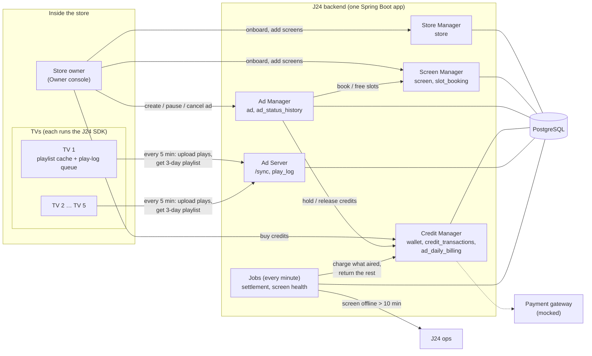
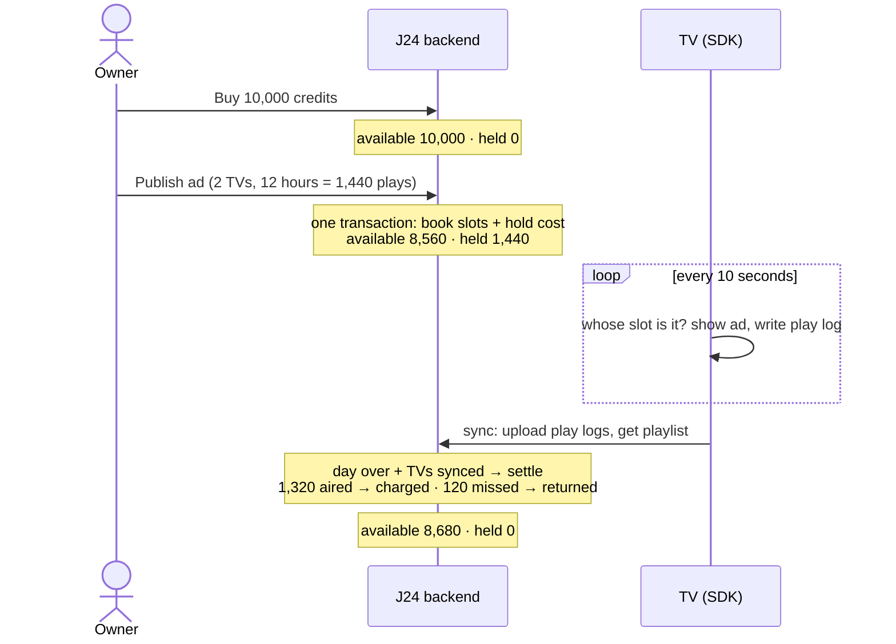

# J24 In-Store Screen Ads

One Spring Boot app (one package per service) on one PostgreSQL database. TVs in the store run the J24 SDK, which pulls its playlist and uploads what it played.

- [01 Architecture diagram](#01-architecture-diagram)
- [02 Database schema](#02-database-schema)
- [03 API endpoints](#03-api-endpoints)
- [04 How credits work](#04-how-credits-work)

---

## 01 Architecture diagram



| Service | Owns | Does |
|---|---|---|
| Store Manager | `store` | Onboards a store and creates its empty wallet |
| Screen Manager | `screen`, `slot_booking` | Registers TVs, tracks last sync, books and frees slots |
| Ad Manager | `ad`, `ad_status_history` | Availability, publish, pause, resume, cancel |
| Credit Manager | `wallet`, `credit_transactions`, `ad_daily_billing` | Buy credits, hold at publish, charge or return at settlement |
| Ad Server | `play_log` | Gives each TV its 3-day playlist, stores the plays it reports |
| Jobs | — | Settlement every minute; alert when a TV hasn't synced for 10 minutes |

---

## 02 Database schema

All sample rows below belong to **one ad on two TVs of Kirana store 1**, so you can follow the same ids across tables.
The ad runs 1 Nov 2026, 09:00–21:00 IST: 720 plays per TV, 1,440 in total, at 1 credit per play.

### 1. store

One row per shop that uses J24.

| Column | Type | Notes |
|---|---|---|
| id | UUID PK | Made by the server |
| owner_name | TEXT NOT NULL | Who runs the shop |
| phone | TEXT | Owner's phone |
| name | TEXT NOT NULL | Shop name shown in the console |
| address | TEXT | Free text |
| created_at | TIMESTAMPTZ NOT NULL | When it was onboarded |

Sample row
```json
{
  "id": "store_kirana_1",
  "owner_name": "Ramesh Sharma",
  "phone": "9876543210",
  "name": "Kirana store 1",
  "address": "MG Road, Bengaluru",
  "created_at": "2026-10-30T10:00:00+05:30"
}
```

### 2. screen

One row per TV. Each TV loops 6 slots of 10 seconds, so there is no separate slots table: a slot is just `slot_index` 0–5.

| Column | Type | Notes |
|---|---|---|
| id | UUID PK | Made by the server, so many stores can onboard at once with no clashes |
| store_id | UUID NOT NULL FK | The store the TV is in |
| name | TEXT NOT NULL | e.g. "Entrance TV" |
| placement_type | TEXT NOT NULL | ENTRANCE / NEAR_CHECKOUT / AISLE / OTHER |
| width_pixels / height_pixels | INT | Screen resolution |
| slots_per_loop | INT NOT NULL DEFAULT 6 | Slots in one loop |
| slot_duration_seconds | INT NOT NULL DEFAULT 10 | Length of one slot |
| status | TEXT NOT NULL | ACTIVE / INACTIVE. Inactive TVs can't be booked and show house content |
| last_seen_at | TIMESTAMPTZ | Last sync. More than 10 minutes old → screen-health alert |
| created_at | TIMESTAMPTZ NOT NULL | Row creation |

Index: `(store_id)`.

Sample rows
```json
[
  {
    "id": "screen_entrance",
    "store_id": "store_kirana_1",
    "name": "Entrance TV",
    "placement_type": "ENTRANCE",
    "width_pixels": 1920, "height_pixels": 1080,
    "slots_per_loop": 6, "slot_duration_seconds": 10,
    "status": "ACTIVE",
    "last_seen_at": "2026-11-01T21:03:00+05:30"
  },
  {
    "id": "screen_checkout",
    "store_id": "store_kirana_1",
    "name": "Checkout TV",
    "placement_type": "NEAR_CHECKOUT",
    "width_pixels": 1920, "height_pixels": 1080,
    "slots_per_loop": 6, "slot_duration_seconds": 10,
    "status": "ACTIVE",
    "last_seen_at": "2026-11-01T21:04:00+05:30"
  }
]
```

### 3. ad

What the owner wants to show, for how long, and what it costs. The image is stored in the row.

| Column | Type | Notes |
|---|---|---|
| id | UUID PK | Made by the server |
| store_id | UUID NOT NULL FK | Owner's store |
| name | TEXT NOT NULL | Internal name |
| headline | TEXT NOT NULL | Text shown over the image |
| image / image_content_type | BYTEA / TEXT | The picture; TVs download it once and cache it |
| start_time / end_time | TIMESTAMPTZ NOT NULL | One continuous range; `end_time > start_time` |
| status | TEXT NOT NULL | ACTIVE / PAUSED / CANCELLED. "ENDED" isn't stored: it's an ACTIVE or PAUSED ad past its end_time |
| price_per_play | BIGINT NOT NULL | 1 credit |
| total_cost | BIGINT NOT NULL | Plays per TV × TVs × price; held at publish |
| idempotency_key | TEXT UNIQUE | From the optional `Idempotency-Key` header, so a retried publish returns the first ad |
| created_at / updated_at | TIMESTAMPTZ NOT NULL | Row creation / last change |

Index: `(store_id, status)`.

Sample row
```json
{
  "id": "ad_diwali_sale",
  "store_id": "store_kirana_1",
  "name": "Diwali sale",
  "headline": "Flat 20% off on sweets",
  "image_content_type": "image/png",
  "start_time": "2026-11-01T09:00:00+05:30",
  "end_time": "2026-11-01T21:00:00+05:30",
  "status": "ACTIVE",
  "price_per_play": 1,
  "total_cost": 1440,
  "idempotency_key": "publish-7f3a",
  "created_at": "2026-10-31T18:00:00+05:30",
  "updated_at": "2026-10-31T18:00:00+05:30"
}
```

### 4. ad_status_history

Every status change, so settlement knows whether the ad was ACTIVE when each play happened. Plays made while paused are not charged, even if an offline TV kept showing the ad.

| Column | Type | Notes |
|---|---|---|
| id | BIGSERIAL PK | |
| ad_id | UUID NOT NULL FK | The ad |
| status | TEXT NOT NULL | The new status |
| changed_at | TIMESTAMPTZ NOT NULL | When it changed |

Index: `(ad_id, changed_at)`.

Sample row
```json
{ "id": 1, "ad_id": "ad_diwali_sale", "status": "ACTIVE", "changed_at": "2026-10-31T18:00:00+05:30" }
```

### 5. slot_booking

One ad on one slot of one TV for a time range. Belongs to Screen Manager because slots belong to a screen.

| Column | Type | Notes |
|---|---|---|
| id | UUID PK | |
| ad_id | UUID NOT NULL FK | The ad that booked it |
| screen_id | UUID NOT NULL FK | The TV |
| slot_index | INT NOT NULL | 0–5 |
| start_time / end_time | TIMESTAMPTZ NOT NULL | Copied from the ad |
| active | BOOLEAN NOT NULL DEFAULT TRUE | Set to false on cancel, which frees the slot. Pause keeps it true |

Indexes: `(screen_id, slot_index, start_time, end_time)` for availability; `(ad_id)`.

A slot is free when no active booking on the same TV and slot overlaps the new range.

Sample rows
```json
[
  { "id": "booking_1", "ad_id": "ad_diwali_sale", "screen_id": "screen_entrance", "slot_index": 2,
    "start_time": "2026-11-01T09:00:00+05:30", "end_time": "2026-11-01T21:00:00+05:30", "active": true },
  { "id": "booking_2", "ad_id": "ad_diwali_sale", "screen_id": "screen_checkout", "slot_index": 0,
    "start_time": "2026-11-01T09:00:00+05:30", "end_time": "2026-11-01T21:00:00+05:30", "active": true }
]
```

### 6. wallet

The store's current balance, one row per store. Locked with `FOR UPDATE` in publish, so two ads can't spend the same credits.

| Column | Type | Notes |
|---|---|---|
| store_id | UUID PK FK | One wallet per store |
| available | BIGINT NOT NULL, CHECK ≥ 0 | Free to spend. The database refuses a negative balance |
| held | BIGINT NOT NULL, CHECK ≥ 0 | Reserved for booked ads that haven't been settled |

Sample row (after the day is settled)
```json
{ "store_id": "store_kirana_1", "available": 8680, "held": 0 }
```

### 7. credit_transactions

The statement: every credit movement, never edited. Written in the same transaction as the wallet change.

| Column | Type | Notes |
|---|---|---|
| id | BIGSERIAL PK | |
| store_id | UUID NOT NULL FK | Whose credits |
| type | TEXT NOT NULL | PURCHASE (bought) / HOLD (reserved at publish) / DEDUCT (charged for plays) / RELEASE (returned) |
| amount | BIGINT NOT NULL, > 0 | Always positive; the type says the direction |
| ad_id | UUID FK | The ad behind the movement; null for PURCHASE |
| created_at | TIMESTAMPTZ NOT NULL | When it happened |

Index: `(store_id, created_at)`.

Sample rows
```json
[
  { "id": 1, "store_id": "store_kirana_1", "type": "PURCHASE", "amount": 10000, "ad_id": null,             "created_at": "2026-10-30T10:00:00+05:30" },
  { "id": 2, "store_id": "store_kirana_1", "type": "HOLD",     "amount": 1440,  "ad_id": "ad_diwali_sale", "created_at": "2026-10-31T18:00:00+05:30" },
  { "id": 3, "store_id": "store_kirana_1", "type": "DEDUCT",   "amount": 1320,  "ad_id": "ad_diwali_sale", "created_at": "2026-11-01T21:05:00+05:30" },
  { "id": 4, "store_id": "store_kirana_1", "type": "RELEASE",  "amount": 120,   "ad_id": "ad_diwali_sale", "created_at": "2026-11-01T21:05:00+05:30" }
]
```

### 8. ad_daily_billing

One row per ad per IST day: how much was held for that day and how it was settled.

| Column | Type | Notes |
|---|---|---|
| id | UUID PK | |
| ad_id | UUID NOT NULL FK | The ad |
| date | DATE NOT NULL | IST day; UNIQUE `(ad_id, date)` |
| booked_plays | INT NOT NULL | Plays booked that day across all its TVs |
| held | BIGINT NOT NULL | Credits held for that day |
| status | TEXT NOT NULL | HELD / SETTLED |
| deducted | BIGINT NOT NULL DEFAULT 0 | Charged: plays that aired while ACTIVE, capped per TV |
| released | BIGINT NOT NULL DEFAULT 0 | Returned: `held − deducted`. CHECK `deducted + released = held` once settled |
| settled_at | TIMESTAMPTZ | When settlement ran |

Index: `(status, date)` for the settlement job, which picks rows with `FOR UPDATE SKIP LOCKED`.

A day settles once it is over and every TV of the ad has synced since, or after 72 hours.

Sample row (the checkout TV was off for 2 hours, so 120 plays didn't air)
```json
{
  "id": "billing_2026_11_01",
  "ad_id": "ad_diwali_sale",
  "date": "2026-11-01",
  "booked_plays": 1440,
  "held": 1440,
  "status": "SETTLED",
  "deducted": 1320,
  "released": 120,
  "settled_at": "2026-11-01T21:05:00+05:30"
}
```

### 9. play_log

One row per play a TV reports. The TV makes `play_id`, so uploading the same batch twice counts it once (`ON CONFLICT DO NOTHING`).

| Column | Type | Notes |
|---|---|---|
| play_id | UUID PK | Made on the TV |
| screen_id | UUID NOT NULL FK | Which TV played it |
| ad_id | UUID NOT NULL FK | Which ad |
| slot_index | INT NOT NULL | Which slot |
| played_at | TIMESTAMPTZ NOT NULL | TV time, corrected with the server-time offset |
| received_at | TIMESTAMPTZ NOT NULL | When it reached the server; can be days later after an outage |

Index: `(ad_id, screen_id, played_at)` for settlement counting.

Sample row
```json
{
  "play_id": "play_9c41",
  "screen_id": "screen_entrance",
  "ad_id": "ad_diwali_sale",
  "slot_index": 2,
  "played_at": "2026-11-01T09:00:20+05:30",
  "received_at": "2026-11-01T09:05:00+05:30"
}
```

---

## 03 API endpoints

All paths start with `/api/v1`. Errors always come back as `{code, message, ...details}`. Full sample payloads are in [`specs.md`](specs.md#6-apis-apiv1).

### Store and screens

- **Onboard store**: `POST /stores` `{name, ownerName, phone, address}` → creates the store and an empty wallet, returns `{storeId}`.
- **List stores**: `GET /stores` → `[{storeId, name, ownerName, phone, address}]`.
- **Add a TV**: `POST /stores/{storeId}/screens` `{name, placementType, widthPixels, heightPixels}` → the server makes the id and returns the screen.
- **List TVs**: `GET /stores/{storeId}/screens` → `[{screenId, name, placementType, slotsPerLoop, slotDurationSeconds, status, online, lastSeenAt}]`. `online` means it synced in the last 10 minutes.
- **Switch a TV on or off for booking**: `PATCH /screens/{screenId}` `{status: "ACTIVE" | "INACTIVE"}` → the updated screen.

### Credits

- **Buy credits**: `POST /stores/{storeId}/credits/purchase` `{credits}` → the mock gateway succeeds at once; credits go to `available` with a PURCHASE row. Returns `{storeId, available, held}`.
- **Balance**: `GET /stores/{storeId}/wallet` → `{storeId, available, held}`.
- **Statement**: `GET /stores/{storeId}/wallet/transactions` → `[{id, type, amount, adId, createdAt}]`, newest first.

### Ads

- **Check availability**: `POST /ads/availability` `{storeId, screenIds, startTime, endTime}` → `{screens: [{screenId, screenName, freeSlots}], playsPerScreen, totalCost, available, missingCredits}`. Nothing is reserved.
- **Publish**: `POST /ads` (multipart: an `ad` JSON part `{storeId, name, headline, startTime, endTime, screens: [{screenId, slotIndex?}]}` and an `image` file; optional `Idempotency-Key` header). In one transaction it locks the wallet, locks the TVs in id order, re-checks slots, books one slot per TV and holds the full cost.
  - `201 {adId, totalCost, bookings: [{screenId, slotIndex}]}`
  - `402 INSUFFICIENT_CREDITS {totalCost, available, missingCredits}`
  - `409 SLOT_TAKEN`: someone booked the slot since the availability check.
- **Pause / resume**: `POST /ads/{adId}/pause`, `POST /ads/{adId}/resume` → the ad summary. No credits move now; plays skipped while paused are returned at settlement. The slot stays booked.
- **Cancel**: `POST /ads/{adId}/cancel` → frees the slots and returns credits for days that haven't started, right away: `{adId, status: "CANCELLED", releasedCredits}`.
- **List ads**: `GET /ads?storeId=` → `[{adId, name, headline, status, startTime, endTime, totalCost, hasImage, createdAt}]`. Status can be ACTIVE, PAUSED, CANCELLED or ENDED.
- **Ad detail**: `GET /ads/{adId}` → `{ad, pricePerPlay, playsReceived, screens: [{screenId, screenName, slotIndex, active}], dailyBilling: [{date, bookedPlays, held, status, deducted, released, settledAt}]}`.
- **Ad image**: `GET /ads/{adId}/image` → the image bytes, cached for 7 days.

### Ad Server (called by the TV's SDK)

- **Sync**: `POST /screens/{screenId}/sync` `{playLogs: [{playId, adId, slotIndex, playedAt}]}` (up to 500 per call, oldest first). The TV calls it every 5 minutes, on start and on reconnect.
  - Returns `{receivedPlayIds, serverTime, playlist}`.
  - `playlist` = `{validUntil (now + 3 days), slotsPerLoop, slotDurationSeconds, screenStatus, items: [{adId, slotIndex, name, headline, startTime, endTime, imageUrl}]}`, always the full 3 days.
  - The TV removes the received ids from its queue and plays by clock: slot = (seconds since midnight IST ÷ 10) mod 6.

### J24 ops (demo helpers)

- **Run settlement now**: `POST /ops/settlement/run?skipGrace=false` → `{settled, deducted, released}`. `skipGrace=true` doesn't wait for offline TVs.
- **Screen alerts**: `GET /ops/alerts` → `[{screenId, storeId, screenName, reason, since}]` for TVs that are inactive or haven't synced in 10 minutes.

---

## 04 How credits work

1 credit = ₹1 = one play that actually aired. The model is **hold → charge → return**, the same as a card hold at a hotel.
The numbers follow the sample rows above.



### 1. Bought (credits added)

- `POST /credits/purchase` → the mock gateway succeeds at once.
- In one transaction: `available += credits` and a **PURCHASE** row.
- Sample: available 0 → **10,000**.

### 2. Assigned (held at publish)

- Cost = plays per TV × number of TVs × 1 credit. A TV plays the ad once a minute, so 12 hours = 720 plays per TV, and 2 TVs = **1,440**.
- In the publish transaction:
  - lock the wallet;
  - if `available < cost`, return `402` with `missingCredits`;
  - otherwise `available −= cost`, `held += cost`, a **HOLD** row, and one `ad_daily_billing` row per IST day (status HELD).
- The credits are reserved, not spent. A booked ad can't run out halfway, and a second ad can't use the same credits.
- Sample: available 10,000 → **8,560**, held 0 → **1,440**.

### 3. Charged and returned (settled per ad per day)

The settlement job runs every minute. It picks a HELD `ad_daily_billing` row when:

- the day is over, **and**
- every TV of the ad has synced since then (so its plays are in), or 72 hours have passed.

For that day:

- **Charged** = plays in `play_log` while the ad was ACTIVE (from `ad_status_history`), capped at that TV's booked plays.
- **Returned** = held − charged. This covers TVs that were off, the ad being paused, or an image that didn't load.
- In one transaction: `held −= held`, `available += returned`, a **DEDUCT** row and a **RELEASE** row, and the billing row is marked SETTLED.
- Sample: the checkout TV was off for 2 hours, so 1,320 aired → **charged 1,320**, **returned 120**. The wallet is now available **8,680**, held **0**.

### 4. Special cases

| Case | What happens to credits |
|---|---|
| Pause | Nothing moves now. Plays skipped while paused are returned at settlement |
| Cancel | Days that haven't started are returned right away (RELEASE). Today settles normally |
| TV offline | It keeps playing from cache and uploads later. Settlement waits up to 72 hours for it |
| Plays uploaded after their day settled | Stored, not charged. J24 absorbs it |
| Same plays uploaded twice | `play_id` is the primary key, so each play counts once |
| Two publishes at once | The wallet row lock makes the second wait. It sees the lower balance and gets `402` |
